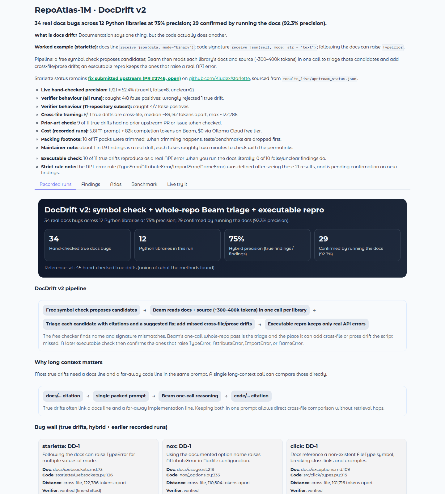
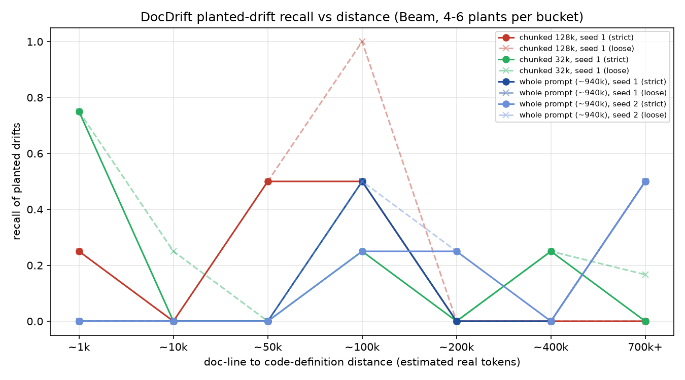

# RepoAtlas-1M



**DocDrift v2** finds docs drift (docs say one thing, code does another) in Python libraries. A free symbol check proposes candidates. Beam reads each library's docs and source (about 300–400k tokens) in one call to triage them and add cross-file or prose drift. A generated script then runs the documented usage and keeps the ones that raise a real API error.

**Results:** 34 real docs bugs in 12 Python libraries. 3 in 4 flagged findings were real (45 of 60); 29 bugs reproduce a real API error when you run the docs. Beam's triage threw away 0 of 32 real bugs. Baselines: `results_live/baselines/baselines.md`. Context probe up to 947,446 tokens: `results_live/recall/recall.md`.

The 12 libraries are starlette, httpx, click, structlog, nox, arrow, cattrs, marshmallow, attrs, jinja, werkzeug and pydantic-settings. Labels were made by an AI reviewer checking file:line evidence, not by a human annotator. The 45-drift reference set is the union of what the methods found, so it favours them.

Starlette story (canonical upstream repo):

- Canonical repo: **https://github.com/Kludex/starlette** (GitHub redirects from encode/starlette).
- Recorded run prompt size: **394,577** tokens.
- Drift: docs line used `receive_json(data, mode="binary")` while code signature has no `data` parameter.
- Result: checked against the source (file:line evidence); true drift.
- The v2 strict repro could not start the test session, so starlette is **not** one of the 29. It did reproduce in an earlier docs-runner (`TypeError`).
- Upstream state: **fix submitted upstream (PR #3746, open)**  
  https://github.com/Kludex/starlette/pull/3746

## What is docs drift?

Docs drift means docs and code disagree in a way that can break users who follow the docs.
Example from starlette:

- docs/websockets.md line 74: `websocket.receive_json(data, mode="binary")`
- starlette/websockets.py line 136: `async def receive_json(self, mode: str = "text") -> Any:`
- following the docs can raise: `TypeError` (multiple values for `mode`)

## How Beam is used (required challenge section)

Numbers below are computed from `results_live/hybrid/hybrid.json`, `results_live/hybrid/repros/repros.json`, and `results_live/recall/`.

1. **Triage filter, not a raw detector**  
   A free AST symbol check proposes name and signature mismatches. Beam then reads each library's docs and source in one packed prompt (~300–400k tokens) and judges those candidates. It rejected **0 of 32** true candidates and removed **15 of 24** false or unclear ones.
2. **New finds Beam added**  
   Beam wrote additional cross-file and prose drifts the checker missed: **13** additions, **9** true, **7** new to the union (for example httpx docs list `Response.next()`, which does not exist). Distinct true drifts go from 24 (symbol check) to 34.
3. **Repro author**  
   Beam wrote every doc-literal repro script (138,138 tokens). **29** distinct bugs reproduce a real API error (`TypeError` / `AttributeError` / `ImportError` / `NameError`). **36 of 39** badged findings were real. **3** badges landed on non-bugs (werkzeug S38, S39, S41). The earlier v1 line “10 of 11 reproduce; 0 of 10 false do” does not apply to v2.
4. **Token calibration**  
   Prompt budgeting uses a calibration factor of **1.22x** (`REPOATLAS_TOKEN_CALIBRATION_FACTOR`) between estimated and observed prompt tokens. On the recall mix the observed ratio was about **1.187**.
5. **Where long context helps (measured)**  
   Whole-repo context lets Beam judge candidates against code anywhere and link far-apart evidence. In the planted-drift test, focused whole-context passes hit **5/6** plants 700k+ tokens apart vs **0/6** for chunking. Beam accepted prompts up to **947,446** tokens with no silent truncation. A single whole-prompt call alone is **not** a better detector than chunking or a symbol check (**5/30** vs **5/30** on seed 1), which is why v2 combines them. Single calls mostly miss docstring drifts.
6. **Citation check**  
   Recorded whole-repo findings are also checked against packed source lines. Exact quote matching is required, with a controlled **±3-line shift** tolerance.

## DocDrift v2 comparison

From `results_live/hybrid/hybrid.csv` (12 libraries; distinct true measured against a 45-drift union) plus the earlier 9-repo chunked baselines in `results_live/baselines/baselines.csv` / `baselines.json`:

| Method | True drifts found | Findings | Precision | Tokens |
|---|---|---|---|---|
| Symbol check alone | 24 of 45 (19 of 33 on the 9-repo union) | 43 | 58.1% | 0 |
| Whole-repo Beam alone | 11 of 45 (11 of 33 on the 9-repo union) | 19 | 57.9% | 4,424,575 |
| Chunked Beam (~32k, 9-repo union) | 15 of 33 | 25 | 60% | 3,529,945 |
| Chunked Beam (~128k, 9-repo union) | 9 of 33 | 13 | 69.2% | 3,342,201 |
| Hybrid (symbol + whole-repo Beam triage) | **34 of 45** (22 of 33) | 60 | **75%** | 4,739,392 triage-only + 4,424,575 earlier whole-repo sweep = **~9.2M** end-to-end |
| Hybrid + repro-confirmed (strict) | **29 of 45** (18 of 33) | 39 | **92.3%** | 4,877,530 new (triage + repro); end-to-end still ~9.2M |

Honest notes, also from `hybrid.json`:

- The **45-drift reference set** is the union of what the methods found, so it favours them. Labels were made by an AI reviewer checking file:line evidence, not by a human.
- Beam triage judged **56** candidates and rejected **0** of 32 true candidates, while removing **15** of 24 false or unclear ones.
- **3** findings got a strict repro badge but are not true drifts (werkzeug S38, S39 and S41).
- structlog: Beam's triage reply had no JSON, so its 6 candidates are shown untriaged.
- Chunked Beam alone found **11** local docstring/prose drifts the hybrid misses.
- The strict repro rule was set after the first repro run.
- No prompt caching was observed on triage calls.

## Where long context helps (planted-drift test)

Sourced from `results_live/recall/` (`context_probe.json`, `recall_by_bucket.csv`, `run_summary.json`, `usage_ledger.json`, `recall.md`).

- **Prompt-size probe:** Beam accepted prompts up to **947,446** prompt tokens in this setup. Nothing above 947k was tried.
- **700k+ separation bucket:** focused whole-context passes hit **5/6** plants on seed 1; chunked 128k and 32k both hit **0/6**.
- **Overall strict recall:** single whole-prompt calls were not better than chunking on seed 1 (**5/30** whole vs **5/30** chunk128k and **5/30** chunk32k).
- **Focused-pass variant:** **11/30** strict on seed 1, at higher cost (4,755,853 tokens total vs 970,653 and 1,029,696 for the chunked runs).
- **Docstring limitation:** single-call whole-context variants mostly miss planted Python docstring drifts (best observed **1/32** in docs-last single-call runs).
- **Caveats:** one run per configuration, 4-6 plants per bucket, and small samples.

Practical recipe supported by this data: use whole-repo context to judge candidates and catch long-range drift, plus a cheap symbol check (and later a chunked pass) for local docstring slips.



## Earlier whole-repo-only sweep (v1 recorded runs)

These numbers are **not** the v2 headline. They come from `results_live/index.json` (17 runs).

- Findings checked against the source (file:line evidence): 11 true / 8 false / 2 unclear = **11/21 (52.4%)**
- Citation verifier: caught **4/8** false positives; wrongly rejected **1** true drift.
- Token spend: **5.81M** prompt + **82k** completion tokens on Beam, `$0` via Ollama Cloud free tier.
- **10/17** packs were trimmed (tests/benchmarks dropped first).
- The v1 executable-check line “10 of 11 reproduce; 0 of 10 false do” is contradicted by v2 (werkzeug S38, S39, S41).

## Space behaviour

- Default view is recorded data (no inference cost).
- v2 hero, What Beam did, comparison table, and notes come from `results_live/hybrid/hybrid.json` / `hybrid.csv`.
- Bug wall includes hybrid true drifts plus earlier recorded-run cards.
- Atlas (all 17 v1 runs) is folded under Benchmark.
- Findings tab defaults to starlette. Starlette's repro badge is labelled as the earlier runner and is not counted in the 29.
- Live tab is a replay when no API key is set.

## Live tab guardrails

- Provider from environment:
  - `BEAM_PROVIDER=ollama` uses `OLLAMA_API_KEY` with `https://ollama.com/v1` and model `beam`.
  - `BEAM_PROVIDER=reflection` is also supported.
- Live execution is blocked if required secrets are missing. The button is disabled without a key.
- Default and maximum **live** pack cap in-app: **150k**. The recorded starlette replay is about **395k** tokens, so a live scan cannot reproduce that pack.
- The packer code default cap is `900000` (`MAX_TOKEN_LIMIT` in `repoatlas/config.py`). The recall probe accepted **947,446** tokens.
- Queue concurrency: **1**.
- Per-IP session limit: **2 runs per hour**.
- Global daily cap: `REPOATLAS_LIVE_DAILY_CAP` (default 24).
- If `OLLAMA_API_KEY` is missing, the tab shows the recorded v2 replay instead of a disabled blank state.
- API keys are never echoed in UI output.

## Dataset export

`dataset/` is prepared for companion publication and includes:

- `dataset/README.md` (dataset card),
- `dataset/runs.jsonl`,
- `dataset/findings.jsonl`,
- `dataset/upstream_status.json`,
- `dataset/reverify_line_shift.json`,
- full `dataset/traces/` and `dataset/upstream_drafts/`.

## Limitations

- Sample size remains limited.
- Citation pass/fail is **not** correctness; it only checks quote alignment.
- The 45-drift universe is the union of method output, so it favours those methods.
- A true drift can still fail the strict repro rule (starlette T1, marshmallow T11, structlog untriaged, werkzeug `input_stream`).
- Three false findings received a repro badge (werkzeug S38, S39, S41).

## Reproduce locally

```bash
python3 -m pip install -r requirements-dev.txt
python3 scripts/build_results_live_index.py
python3 -m pytest -q
python3 app.py
```

Optional live benchmark command:

```bash
BEAM_PROVIDER=ollama OLLAMA_API_KEY=YOUR_KEY python3 scripts/run_benchmark.py --repos-file benchmarks/repos_sweep_2026-10-26.yaml --repos httpx,click,attrs,pydantic-settings,structlog,jinja,nox,arrow,cattrs,marshmallow,werkzeug --token-limits 400000 --output-dir results_live
```
