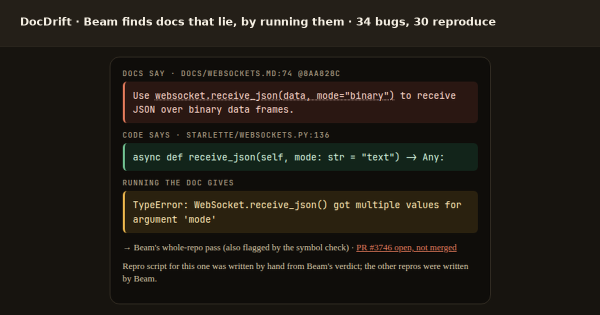

# DocDrift

Repo name: **RepoAtlas-1M**. The code in this repository is [MIT](LICENSE) (copyright 2026 Olly McBride). Dataset labels in the companion dataset are [CC BY 4.0](https://creativecommons.org/licenses/by/4.0/); quoted library docs and source remain under each project's own licence.

The public Space is a **static recording** ([ollymcbride4/docdrift](https://huggingface.co/spaces/ollymcbride4/docdrift)); it makes no Beam calls. Companion dataset: [ollymcbride4/docdrift-bugs](https://huggingface.co/datasets/ollymcbride4/docdrift-bugs).



**DocDrift** finds docs drift (docs say one thing, code does another) in Python libraries. A free symbol check proposes candidates. Beam reads each library's docs and source (about 300–400k tokens) to triage them and add cross-file or prose drift. 11 of 12 libraries were triaged in one call; structlog failed; cattrs needed 2 calls. A generated script then runs the documented usage and keeps the ones that raise a real API error.

**Results:** 34 real docs bugs in 11 of 12 Python libraries. 3 in 4 flagged findings were real (45 of 60; these 45 are 34 distinct bugs); 30 bugs reproduce a real API error when you run the docs. Beam's triage threw away 0 of 32 real bugs. Baselines: `results_live/baselines/baselines.md`. Context probe up to 947,446 tokens: `results_live/recall/recall.md`.

The 12 libraries are starlette, httpx, click, structlog, nox, arrow, cattrs, marshmallow, attrs, jinja, werkzeug and pydantic-settings (pydantic-settings had none). Labels were checked against the source by an AI reviewer. The stored field is still `hand_verdict`. The 45-drift reference set is the union of what the methods found, so it favours them. That pool is a different 45 from the 45 true hybrid findings.

Starlette story (canonical upstream repo):

- Canonical repo: **https://github.com/Kludex/starlette** (GitHub redirects from encode/starlette).
- Recorded run prompt size: **394,577** tokens.
- Drift: docs line used `receive_json(data, mode="binary")` while code signature has no `data` parameter.
- Result: checked against the source (file:line evidence); true drift.
- The strict repro raises `TypeError: WebSocket.receive_json() got multiple values for argument 'mode'` on the DOC-LITERAL `receive_json(data, mode="binary")` line, so starlette **is** one of the 30. The script was written by hand from Beam's verdict (no extra Beam tokens).
- Upstream state: **fix submitted upstream (PR #3746, open)**
  https://github.com/Kludex/starlette/pull/3746
- Nox: **fix submitted upstream (PR #1216, open)**
  https://github.com/wntrblm/nox/pull/1216
- httpx #3774 and arrow #1355 were **already reported upstream by others**.

## What is docs drift?

Docs drift means docs and code disagree in a way that can break users who follow the docs.
Example from starlette:

- docs/websockets.md line 74: `websocket.receive_json(data, mode="binary")`
- starlette/websockets.py line 136: `async def receive_json(self, mode: str = "text") -> Any:`
- following the docs can raise: `TypeError` (multiple values for `mode`)

## How Beam is used (required challenge section)

Numbers below are computed from `results_live/hybrid/hybrid.json`, `results_live/hybrid/repros/repros.json`, `results_live/recall/`, `results_live/ablation/results.json`, and `results_live/beamv3/results.json`.

1. **Triage filter, not a raw detector**
   A free AST symbol check proposes name and signature mismatches. Beam then reads each library's docs and source in one packed prompt (~300–400k tokens) and judges those candidates. 11 of 12 libraries were triaged; structlog failed; cattrs needed 2 calls. It rejected **0 of 32** true candidates and removed **15 of 24** false or unclear ones.
2. **New finds Beam added**
   Beam wrote additional cross-file and prose drifts the checker missed: **13** additions, **9** true, **7** new to the union (for example httpx docs list `Response.next()`, which does not exist). Distinct true drifts go from 24 (symbol check) to 34.
3. **Repro author**
   Beam wrote the doc-literal repro scripts (138,138 tokens). The starlette headline script was written by hand from Beam's verdict. **30** distinct bugs reproduce a real API error (`TypeError` / `AttributeError` / `ImportError` / `NameError`). **38 of 41** badged findings were real. **2 false + 1 unclear** received a strict badge (werkzeug S38, S39 false; S41 unclear).
4. **Token calibration**
   Prompt budgeting uses a calibration factor of **1.22x** (`REPOATLAS_TOKEN_CALIBRATION_FACTOR`) between estimated and observed prompt tokens. On the recall mix the observed ratio was about **1.187**. Packs are capped at 400k so a whole repo plus 32k output fits with headroom; Beam accepted 947,446 in a probe. 5 of 12 first-sweep packs hit the remaining-budget cutoff (attrs, click, httpx, starlette, werkzeug). The packer puts tests, CI and examples last; exact dropped paths were not recorded in the traces.
5. **Long context is grounding, not a verdict-accuracy lift**
   On the same 56 judged candidates, whole-repo vs local-file triage kept **32/32** true and rejected **15/24** false in both conditions. They disagreed on 6 cases, split 3-3. Whole-repo cited the real file:line in **25/30** cross-file cases vs **14/30** for local, and **11/13** vs **0/13** when the evidence lives outside the candidate's own files, at ~4.8× tokens (4,022,532 vs 830,527). Stability rerun: **26/27** verdicts matched. Long context didn't make verdicts more accurate here; it made them cite the real evidence across files, which is what we verify and show maintainers.
6. **Citation check**
   Recorded whole-repo findings are also checked against packed source lines. Exact quote matching is required, with a controlled **±3-line shift** tolerance.

## DocDrift comparison

From `results_live/hybrid/hybrid.csv` (12 libraries; distinct true measured against a 45-drift union) plus the earlier 9-repo chunked baselines in `results_live/baselines/baselines.csv` / `baselines.json`:

| Method | True drifts found | Findings | Precision | Tokens |
|---|---|---|---|---|
| Symbol check alone | 24 of 45 (19 of 33 on the 9-repo union) | 43 | 58.1% | 0 |
| Whole-repo Beam alone | 11 of 45 (11 of 33 on the 9-repo union) | 19 | 57.9% | 4,424,575 |
| Chunked Beam (~32k, 9-repo union) | 15 of 33 | 25 | 60% | 3,529,945 |
| Chunked Beam (~128k, 9-repo union) | 9 of 33 | 13 | 69.2% | 3,342,201 |
| Hybrid (symbol + whole-repo Beam triage) | **34 of 45** (22 of 33) | 60 | **75%** | 4,739,392 hybrid triage + 4,424,575 first sweep = **9,163,967 (~9.2M, both whole-repo passes)** |
| Hybrid + repro-confirmed (strict) | **30 of 45** (19 of 33) | 41 | **92.7%** | **9,302,105 (~9.3M)** = 4,424,575 + 4,739,392 + 138,138 |

Honest notes, also from `hybrid.json`:

- The **45-drift reference set** is the union of what the methods found, so it favours them. Labels were checked against the source by an AI reviewer. The stored field is still `hand_verdict`. That pool is a different 45 from the 45 true hybrid findings.
- Beam triage judged **56** candidates and rejected **0** of 32 true candidates, while removing **15** of 24 false or unclear ones. 11 of 12 libraries were triaged; structlog failed; cattrs needed 2 calls.
- **2 false + 1 unclear** received a strict repro badge (werkzeug S38, S39 false; S41 unclear).
- structlog: Beam's triage reply had no JSON, so its 6 candidates are shown untriaged.
- Chunked Beam alone found **11** local docstring/prose drifts the hybrid misses.
- The strict repro rule was set after the first repro run.
- No prompt caching was observed on triage calls.
- Both whole-repo passes (first sweep + hybrid triage) cost about **9.2M** tokens (4,424,575 + 4,739,392 = 9,163,967). End-to-end including repro is **9,302,105 (~9.3M)**.
- The local-file vs whole-repo ablation spent **1,948,469** extra tokens. That ledger is not part of the 9.3M hybrid end-to-end.
- The docs-pass + py32k beam v3 experiment spent **7,713,453** extra tokens. That ledger is not part of the 9.3M hybrid end-to-end. Headline coverage stays **34 of 45**.
- The matched-cost retrieval control spent **3,957,434** extra tokens, and its pre-registered extension **7,528,878** more. The tomlkit `docdrift run` recording spent **185,842**. Matched-cost controls spent 3,957,434 + 7,528,878 (extension). Together with the recording that is **11,672,154**, not part of the 9.3M hybrid end-to-end.

## Does long context help?

Sourced from `results_live/ablation/results.json` (scored by `scripts/ablation_score.py`).

**Long context didn't make verdicts more accurate here; it made them cite the real evidence across files, which is what we verify and show maintainers.**

The table is generated from that file:

| Metric | Whole-repo (reused hybrid) | Local-file only | Whole-repo, subset (27) | Local, subset (27) | Whole-repo rerun, subset (27) |
|---|---|---|---|---|---|
| True candidates kept | 32/32 | 32/32 | 13/13 | 13/13 | 13/13 |
| False/unclear candidates rejected | 15/24 | 15/24 | 9/14 | 12/14 | 10/14 |
| Precision (kept that are true) | 0.78 (32/41) | 0.78 (32/41) | 0.722 (13/18) | 0.867 (13/15) | 0.765 (13/17) |
| Verdict accuracy | 0.839 | 0.839 | 0.815 | 0.926 | 0.852 |
| Citation hits gold file:line (gradable) | 41/52 | 34/52 | 19/26 | 19/26 | 22/26 |
| Right verdict + gold citation | 39/52 | 33/52 | 17/26 | 19/26 | 20/26 |
| Citation verified (quote matches source) | 54/56 | 52/56 | 25/27 | 26/27 | 27/27 |
| Cross-file cases: right verdict | 26/30 | 26/30 | 12/13 | 12/13 | 12/13 |
| Cross-file cases: right verdict + citation | 25/30 | 14/30 | 12/13 | 8/13 | 12/13 |
| Evidence outside local context: right verdict | 12/13 | 12/13 | 4/4 | 4/4 | 4/4 |
| Evidence outside local context: right verdict + citation | 11/13 | 0/13 | 4/4 | 0/4 | 4/4 |
| Beam tokens | 4,022,532 (11 calls; 4,331,995 as spent incl. a cattrs re-send) | 830,527 (56 calls; 848,654 as spent incl. 1 re-send) | — | — | 1,099,815 |

- n=56 judged candidates (structlog excluded). Labels and gold file:line were checked against the source by an AI reviewer.
- Whole-repo is one call per repo; local is one call per candidate and was given every file the candidate already named.
- 6 of 56 disagreements split 3-3, within run-to-run noise (stability rerun: 26/27).
- Whole-repo 4,022,532 tokens vs local 830,527 (~4.8×). This ablation run's own ledger is **1,948,469** tokens over 60 calls. That is extra experimental cost, not part of the 9.3M hybrid end-to-end.

Full write-up: `results_live/ablation/ablation.md`.

### Matched-cost control

Sourced from `results_live/ablation/matched_cost/results.json` (scored by `scripts/matched_score.py`). Pre-registered in `results_live/ablation/matched_cost/design.md`.

**Is it the whole repo, or just more tokens?** A retrieval baseline got the *same* Beam budget as whole-repo triage: **3,957,434** against **4,022,532** tokens as spent (**3,888,241** attributable; 96.7% of whole-repo) over the same 56 candidates. Each item got the local files plus symbol definitions, imports and BM25 matches that fit in about 56k tokens.

Verdict accuracy came out the same (**46/56** against **47/56**). Grounding still favoured the whole repo: right verdict *and* right cross-file line in **25/30** vs **19/30**; evidence outside the local files **11/13** vs **6/13**. Retrieval pulled in importers or re-exports rather than the defining file in **5 of 13** outside-local items. Exact McNemar p = **0.070** on the cross-file grounding gap, so on these 56 alone this is **"not shown at this n"**.

**Pre-registered extension.** To test that gap at a larger n, 63 more items were added (57 planted synonym-swap renames across 6 libraries, plus 6 real structlog candidates). The design, items and scripts were frozen before any extension Beam call: `results_live/ablation/matched_cost_ext/preregistration_ext.json` (sha256 `design_ext.md` 42f6b6fe…c996, `items.json` 4f454224…a888, `scripts/ext_run.py` 687323a3…cc39, `scripts/ext_score.py` c17e299d…1721). Pooled over 78 cross-file items, the right verdict *and* the right line came out **52/78** for the whole repo against **38/78** for retrieval (20 vs 6 discordant; exact McNemar p = **0.0094**). That meets the pre-registered bar. Verdict accuracy still did not differ (**108/119** vs **105/118**; p = 0.55). Evidence outside the local files: **38/61** vs **25/61** (p = **0.0146**). Caveats: the new items alone give p = 0.096, which is "not shown at this n". The pooled result depends on the pre-registered re-send of one whole-repo call that failed to parse (p = 0.18 without it). Planted renames hide the new name from lexical retrieval. One retrieval call timed out and was not resent (n = 78, not 79). The extension spent **7,528,878** tokens: retrieval 4,417,886, about 1.9× whole-repo's 2,279,494 on the new items. Item-level extension verdicts ship as dataset config `matched_cost_ext_verdicts` (63 scored rows in that file; the pooled 52/78 includes the original 56 from `ablation_verdicts`).

Whole-repo context doesn't make Beam *judge* better here; it helps Beam *point at the right line* more often, for no more spend than retrieval.

Full write-up: `results_live/ablation/matched_cost/report.md`; extension: `results_live/ablation/matched_cost_ext/results_ext.md`.

## Catching what one whole-repo call misses

Sourced from `results_live/beamv3/results.json` (scored by `scripts/beamv3_analyze.py`, no Beam calls). This is a Benchmark-tab experiment, **not** a headline number. Headline coverage stays **34 of 45**.

**32k docstring chunks (py32k) recovered 7 of the 11 drifts hybrid missed; the docs-focused whole-context pass recovered 1; 3 prose-doc drifts are still missed. Union coverage 34 → 42 of 45.** Marginal cost ~140k tokens per extra drift for py32k vs ~1.5M for the docs pass. Precision of the new findings is a **lower bound**: **18.5%** for hybrid+py32k new items (**60%** among labelled); most are unlabelled and are not counted as true. **7** new true drifts sit outside the labelled 45 (AI reviewer checking against source). Stability repeat: **18/19** verdicts agreed.

Recommended: symbol check + whole-repo Beam triage, plus 32k docstring chunks if you want more coverage at lower precision.

The table is generated from that file:

| mode | findings | true | false | unclear | unlabelled | precision LB | among labelled | of 45 | extra of 45 vs hybrid | new (AI) | tokens | tokens / distinct true | marginal tokens / extra drift |
|---|---|---|---|---|---|---|---|---|---|---|---|---|---|
| Hybrid (existing, for reference) | 60 | 45 | - | - | - | 75.0% | - | 34 | - | - | 4,739,392 | 139,394 | - |
| Hybrid + repro strict (existing) | 41 | 38 | - | - | - | 92.7% | - | 30 | - | - | 4,877,530 | - | - |
| (a) docs-focused pass alone | 43 | 17 | 8 | 2 | 16 | 39.5% | 63.0% | 15 | 1 | 2 | 4,485,924 | 263,878 | - |
| (b) py32k docstring chunks alone | 72 | 18 | 3 | 5 | 46 | 25.0% | 69.2% | 13 | 7 | 5 | 1,680,568 | 93,365 | - |
| Hybrid + (a): new items only | 26 | 4 | 4 | 2 | 16 | 15.4% | 40.0% | 35 | 1 | 2 | 9,225,316 | 249,333 | 1,495,308 |
| Hybrid + (b): new items only | 65 | 12 | 3 | 5 | 45 | 18.5% | 60.0% | 41 | 7 | 5 | 6,419,960 | 139,564 | 140,047 |
| Hybrid + (a) + (b): new items only | 91 | 16 | 7 | 7 | 61 | 17.6% | 53.3% | 42 | 8 | 7 | 10,905,884 | 222,569 | 411,099 |
| Hybrid + v3 new items strict-confirmed by repro | 17 | 4 | 0 | 0 | 13 | 23.5% | 100.0% | 36 | 2 | 2 | 11,344,203 | 298,532 | 1,651,203 |

- Precision LB = labelled-true / all findings. Unlabelled findings are not counted as true.
- 'Among labelled' is biased upward: the labelled items are the ones that hit known drifts.
- 15 new-item labels were checked against the source by an AI reviewer at the pack ref, not a human maintainer. Unclear counts as not-true.
- 3 still-missed drifts are prose-doc: C:attrs-py2-reprs, C:httpx-sslcontext, C:mm-quotes-400.
- This run's own ledger is **7,713,453** tokens over 168 calls. That is extra experimental cost, not part of the 9.3M hybrid end-to-end.
- The shipped CLI is symbol check + one whole-repo triage + executable repro. 32k docstring chunks are an experimental extra pass (`scripts/beamv3.py`), not a `--docstring-chunks` flag.

Full write-up: `results_live/beamv3/beamv3.md`.

## Planted-drift distance probe

Sourced from `results_live/recall/` (`context_probe.json`, `recall_by_bucket.csv`, `run_summary.json`, `usage_ledger.json`, `recall.md`). This is a distance probe, not a claim that long context improves triage accuracy or precision.

- **Prompt-size probe:** Beam accepted prompts up to **947,446** prompt tokens in this setup. Nothing above 947k was tried.
- **700k+ separation bucket:** focused whole-context passes hit **5/6** plants on seed 1 only; chunked 128k and 32k both hit **0/6**. Focused passes cost ~4.8× tokens (4,755,853 vs ~1.0M).
- **Overall strict recall:** single whole-prompt calls were not better than chunking on seed 1 (**5/30** whole vs **5/30** chunk128k and **5/30** chunk32k).
- **Focused-pass variant:** **11/30** strict on seed 1, at higher cost (4,755,853 tokens total vs 970,653 and 1,029,696 for the chunked runs).
- **Docstring limitation:** single-call whole-context variants mostly miss planted Python docstring drifts (best observed **1/32** pooled over 2 seeds: 0/18 + 1/14).
- **Caveats:** one run per configuration, 4-6 plants per bucket, and small samples.

Recommended: symbol check + whole-repo Beam triage, plus 32k docstring chunks if you want more coverage at lower precision. Whole-repo context is still what points the citation at the real file:line.


## Limits

- Sample size remains limited.
- Citation pass/fail is **not** correctness; it only checks quote alignment (±3-line shift allowed).
- The 45-drift universe is the union of method output, so it favours those methods. That pool is a different 45 from the 45 true hybrid findings.
- A true drift can still fail the strict repro rule (marshmallow T11, structlog untriaged, werkzeug `input_stream`).
- 2 false + 1 unclear received a repro badge (werkzeug S38, S39 false; S41 unclear).
- Packs are capped at 400k so a whole repo plus 32k output fits with headroom; Beam accepted 947,446 in a probe. 5 of 12 first-sweep packs hit the remaining-budget cutoff (attrs, click, httpx, starlette, werkzeug). The packer puts tests, CI and examples last; exact dropped paths were not recorded in the traces.
- Recorded run logs under `results_live/` contain local `/workspace` and `/tmp` paths from those runs; they are provenance, not secrets.

## Glossary

- **Triage:** Beam judges symbol-check and whole-repo candidates as true_drift, false, or unclear against one packed library prompt.
- **Strict badge:** TypeError, AttributeError, ImportError, or NameError raised on a DOC-LITERAL usage line.
- **Line-shifted match:** the cited quote matched packed source within ±3 lines of the model-cited line.
- **hand_verdict:** stored field name. It means checked against the source by an AI reviewer, not a human annotator.

## Run it on your repo

```bash
pip install git+https://github.com/OlsOls4/repoatlas-1m
export OLLAMA_API_KEY=YOUR_KEY
docdrift run https://github.com/OWNER/REPO --max-tokens 400000 --out findings
```

Typical recorded cost: tomlkit: 185,842 tokens, 96 s.

```
[1/4] symbol check: tomlkit @ d7def7d
      0 symbol flags
[2/4] packing the whole repository (RepoAtlas packer)
```

Or a local checkout:

```bash
docdrift run ./my-library --max-tokens 400000 --out findings
```

Uses the pipeline: free symbol check, then one whole-repo Beam triage (docs and source first, up to the token cap, 32k output tokens, citation verify) via an OpenAI-compatible endpoint (default `https://ollama.com/v1`, model `beam`, key from `OLLAMA_API_KEY` or `OLLAMA_API_KEY_FILE`), then an executable repro in an isolated venv with no network (skip with `--no-repro`; cap with `--repro-budget`). Stops on HTTP 402/quota (exit 4). The command prints a token-estimate preflight and refuses to call Beam if the estimate exceeds `--max-tokens`. Create a free Ollama Cloud key at https://ollama.com (Settings → API keys). No key is stored in this repository. Replay scripts (`scripts/hybrid_triage.py` and friends) read **`OLLAMA_API_KEY` first**; if that is unset they try `OLLAMA_API_KEY_FILE`.

`--docstring-chunks` is not a shipped flag (it would be a second Beam pass, not a one-liner). The experimental 32k docstring-chunk pass lives in `scripts/beamv3.py`. Recommended: symbol check + whole-repo Beam triage, plus 32k docstring chunks if you want more coverage at lower precision.

## Reproduce locally

```bash
python3 -m pip install -r requirements-dev.txt
python3 scripts/build_results_live_index.py
python3 -m pytest -q
python3 scripts/build_static.py
python3 scripts/build_hf_dataset.py
```

Optional live benchmark command:

```bash
BEAM_PROVIDER=ollama OLLAMA_API_KEY=YOUR_KEY python3 scripts/run_benchmark.py --repos-file benchmarks/repos_sweep_2026-10-26.yaml --repos httpx,click,attrs,pydantic-settings,structlog,jinja,nox,arrow,cattrs,marshmallow,werkzeug --token-limits 400000 --output-dir results_live
```
